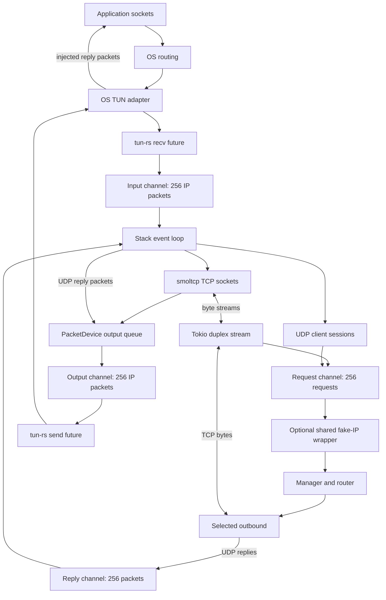
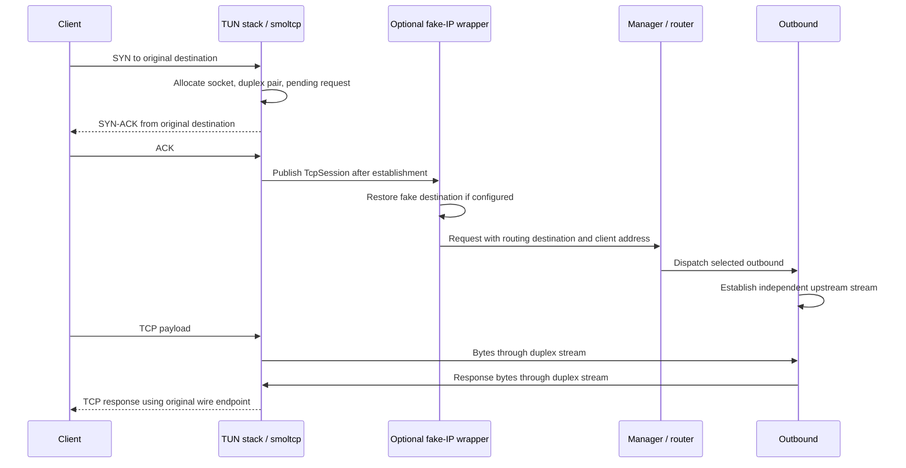
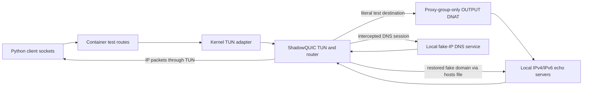

# TUN inbound implementation specification

This document describes the implementation at commit `12f83de`. It is an
implementation reference: behavior described here exists in the code unless
explicitly identified as a limitation. Operator setup is documented separately
in [TUN inbound](../document/tun.md).

## 1. Purpose and integration contract

The TUN inbound converts layer-3 IPv4/IPv6 TCP and UDP traffic into ShadowQUIC's
existing `ProxyRequest` interface. The manager routes these requests to the same
outbounds used by SOCKS, mixed, and TPROXY inbounds.

The responsibilities are:

- `tun-rs` creates and configures the OS adapter and reads/writes IP packets.
- `smoltcp` terminates the application's TCP connections and handles TCP state,
  acknowledgments, retransmission, windows, and segmentation. Its wire types also
  parse IP/UDP packets and construct UDP replies.
- The TUN adapter code connects TCP byte streams and UDP datagrams to
  `TcpSession` and `UdpSession`.
- `Config::build_manager` attaches the shared DNS fake-IP restoration wrapper
  when a fake-IP service is configured.
- The existing manager, router, and outbound implementations select and perform
  the upstream connection or datagram exchange.
- The operating system's routing configuration determines which traffic enters
  TUN. The inbound does not install a capture/default route or change DNS settings.

TCP is terminated locally and bridged to an independent outbound stream. A
successful application-side TCP handshake therefore does not imply that an
upstream connection has already succeeded.

## 2. Features, dependencies, and platform gates

The feature declaration is:

```toml
tun = ["dep:tun-rs", "dep:smoltcp", "dep:ipnet"]
```

`tun` is opt-in and is absent from the default feature list. Without it, the
`crate::tun` module, `TunServerCfg` re-export, and `InboundCfg::Tun` variant are
absent. Deserializing `type: tun` fails rather than silently selecting another
inbound. Default builds do not pull in `tun-rs` or `smoltcp` through this feature.
`ipnet` can still be enabled independently by `dns-server`.

The module, configuration variant, and `tun-rs` dependency are additionally gated
to Linux, macOS, or Windows. This implementation does not expose a TUN inbound
on Android, iOS, or the BSD targets.

| Dependency or feature | Use |
| --- | --- |
| `tun-rs` 2, `async_tokio` | Async OS TUN adapter |
| `smoltcp` 0.12 | Userspace TCP stack and packet wire formats |
| smoltcp `std`, `medium-ip`, `proto-ipv4`, `proto-ipv6`, `socket-tcp` | Selected stack capabilities; default smoltcp features are disabled |
| `ipnet` with Serde support | Typed IPv4/IPv6 CIDR configuration |
| Existing Tokio dependency | Channels, duplex streams, task lifecycle, readiness, timers |
| `dns-server` | Optional fake-IP service and restoration integration |
| `plugin` | Optional Lua routing; ordinary TUN proxying does not require Lua |

TUN does not depend on the `tproxy` feature. Fake-IP restoration must remain
available with `tun,dns-server` enabled and `tproxy` disabled. The Docker test
builds precisely that combination, alongside the transport and Lua features it
uses.

## 3. Source map

| File | Responsibility |
| --- | --- |
| [tun/config.rs](../shadowquic/src/tun/config.rs) | `TunServerCfg`, defaults, validation |
| [tun/mod.rs](../shadowquic/src/tun/mod.rs) | Public `TunServer`, device creation, packet I/O, accept/shutdown/drop |
| [tun/packet.rs](../shadowquic/src/tun/packet.rs) | IP validation and UDP reply construction |
| [tun/stack.rs](../shadowquic/src/tun/stack.rs) | smoltcp device/interface, TCP bridging, UDP sessions, event loop |
| [tun/tests.rs](../shadowquic/src/tun/tests.rs) | In-memory packet tests and privileged device smoke test |
| [config/mod.rs](../shadowquic/src/config/mod.rs) | Inbound enum, global validation, manager construction, restoration wrapper selection |
| [lib.rs](../shadowquic/src/lib.rs) | `Inbound`, `ProxyRequest`, session and stream contracts |
| [dns/imple/integration.rs](../shadowquic/src/dns/imple/integration.rs) | Shared `RestoringInbound`, `RestoringRecv`, `MappedSend` |
| [dns/imple/fakeip.rs](../shadowquic/src/dns/imple/fakeip.rs) | Shared domain/index/address mapping |
| [scripts/test_suite/test_tun.py](../scripts/test_suite/test_tun.py) | Host build and Docker runner |
| [scripts/test_tun.py](../scripts/test_tun.py) | Actual kernel-level integration test inside Docker |

## 4. Configuration

The inbound discriminator is `type: tun`. `TunServerCfg` derives `Deserialize`,
`Clone`, and `Debug`, uses kebab-case field names, and rejects unknown fields.

```yaml
inbounds:
  - tag: tun-in
    type: tun
    name: sq-tun0
    ipv4: 172.19.0.1/30
    ipv6: fdfe:dcba:9876::1/126
    mtu: 1500
    max-sessions: 1024
    idle-timeout: 300
    default-outbound: direct
outbounds:
  - tag: direct
    type: direct
```

| Field | Rust type | Default | Meaning and validation |
| --- | --- | --- | --- |
| `tag` | `String` | Required | Manager validation requires a nonempty, unique endpoint label |
| `default-outbound` | `Option<String>` | Unset | Manager validates the referenced outbound/DNS tag; copied to each request's routing preference |
| `name` | `Option<String>` | OS chooses | If supplied, must be nonempty and contain no NUL; further naming restrictions are enforced by the OS/library |
| `ipv4` | `Ipv4Net` | `172.19.0.1/30` | Adapter's IPv4 address and prefix |
| `ipv6` | `Ipv6Net` | `fdfe:dcba:9876::1/126` | Adapter's IPv6 address and prefix |
| `mtu` | `u16` | `1500` | `1280..=65535`; IPv6 determines the minimum |
| `max-sessions` | `usize` | `1024` | `1..=65536`; combined TCP-flow and UDP-client-session limit |
| `idle-timeout` | `u64` | `300` seconds | `1..=86400`; strict UDP inactivity threshold and smoltcp TCP timeout setting |

`ipv4` and `ipv6` are interface addresses: host bits are expected and preserved.
They are different from the network-aligned `ipv4-range`/`ipv6-range` fields of a
`dns-fakeip` service. Both interface families are configured; there is no
family-disable setting.

Validation rejects unspecified and multicast interface addresses and the IPv4
limited broadcast address `255.255.255.255`. Address-family and prefix syntax
are validated by the typed CIDR deserialization. Other adapter configuration
errors propagate from `tun-rs` as I/O errors.

`Config::validate` checks TUN configuration before building any listeners.
`TunServer::new` also calls `TunServerCfg::validate` for standalone API callers.
The manager's endpoint/tag-reference checks belong to `Config::validate`.

## 5. Architecture and ownership



`TunServer` owns the actual device name, the request receiver, and a
`Mutex<Option<JoinHandle<Result<(), SError>>>>`. Its `accept` method receives an
already constructed request. It does not read or parse device packets itself.

There is one spawned background Tokio task per TUN adapter. Inside that task,
`tokio::try_join!` drives three futures concurrently:

1. The reader borrows the async device and feeds the input channel.
2. The writer borrows the same device and drains the output channel.
3. `stack::run` owns the userspace interface, socket set, and session maps.

These are three cooperating futures, not three separately spawned tasks or
per-connection worker tasks. An error from any future ends the joined operation
and drops the other futures. TCP bridging does not spawn a task per connection.

## 6. Device creation and smoltcp interface

### OS device

`TunServer::new` applies the configured IPv4 address/prefix, IPv6 address/prefix,
and MTU with `DeviceBuilder`, optionally applies the requested name, and calls
`build_async`. On macOS it explicitly sets `associate_route(false)`.

The code uses packet-oriented `recv` and `send`. It does not configure TAP,
Ethernet framing, multiqueue, packet batching, or offload features. Platform device
handling is delegated to `tun-rs`; the stack expects each received buffer to begin
with an IP header.

The reader uses a 65,535-byte scratch buffer. A successful read is copied into
owned `Bytes` before being sent to the stack. The writer requires `send` to report
the complete packet length; a short successful write becomes `WriteZero`.

The adapter is created during inbound construction, before the manager's accept
loop starts. No extra TUN-specific work is performed by `Inbound::init`.

### In-memory device

`PacketDevice` implements `smoltcp::phy::Device` with:

- `Medium::Ip` and the configured MTU.
- `max_burst_size = Some(64)`.
- An input `VecDeque<Bytes>` and output `VecDeque<Vec<u8>>`.
- An RX token that owns a received packet and exposes its bytes to smoltcp.
- A TX token that allocates a packet buffer, lets smoltcp fill it, and queues it.

When the output deque reaches 256 packets, `receive` and `transmit` stop supplying
tokens. An incoming TCP packet therefore does not get processed without space
for an immediate protocol reply.

The input deque is fed by the stack's synchronous `ingest` operation and consumed
by interface polling. Its pressure is controlled by the surrounding event loop
and bounded channels; it has no separate fixed-capacity container type.

### Interface

The smoltcp interface uses `HardwareAddress::Ip`, the configured interface CIDRs,
and a randomized seed derived by hashing the tag with a fresh `RandomState`.
It owns a `SocketSet<'static>` with heap-owned socket buffers.

AnyIP is enabled. The interface installs an IPv4 and an IPv6 default route whose
gateway is the corresponding configured local address. This lets smoltcp accept
TCP packets addressed to destinations other than the adapter's own addresses.
These routes exist only inside smoltcp; they do not install OS capture routes.

## 7. Event loop and scheduling

`stack::run` creates a bounded UDP-reply channel and records a Tokio monotonic
epoch. On each iteration it:

1. Converts elapsed monotonic time to smoltcp milliseconds.
2. Calls `Stack::poll`: poll the interface, expire UDP sessions, and remove TCP
   sockets that are no longer open.
3. Drains the device's output deque into the bounded output channel, awaiting
   capacity when necessary.
4. Obtains smoltcp's next poll delay. No deadline means one second; any deadline
   is capped at one second.
5. Selects between the next input packet, UDP reply, TCP-bridge readiness, and
   timer expiration.
6. Processes the selected event and repeats.

Equivalent scheduling pseudocode:

```text
loop:
    now = monotonic milliseconds since stack start
    poll smoltcp and reap sessions
    await transfer of all pending output packets to writer channel
    delay = min(smoltcp next delay or 1 second, 1 second)
    select:
        input packet -> ingest, or return success if input channel closed
        UDP reply    -> validate session/generation, queue output
        bridge ready -> move available TCP bytes / process EOF
        timer        -> poll again
```

`poll_fn` supplies the stack task's waker when reading/writing duplex streams.
Application-side reads and writes can therefore wake TCP bridging without
waiting for the one-second timer. smoltcp supplies TCP protocol deadlines.

Session cleanup runs as part of polling, not in a separate timer task. One second
is a maximum scheduled sleep, not a hard real-time cleanup guarantee: a blocked
output channel or a delayed executor can postpone subsequent polling.

## 8. Packet admission

`Stack::ingest` first rejects packets larger than the configured MTU.
`Packet::parse` then validates the version and IP representation through smoltcp.

| Input | Processing |
| --- | --- |
| IPv4 | Checked packet length and representation/checksum parsing |
| Fragmented IPv4 | Drop if `more_frags` is set or fragment offset is nonzero |
| IPv6 | Checked fixed header and representation parsing |
| Unspecified source/destination | Drop |
| Multicast source/destination | Drop |
| IPv4 limited broadcast source/destination | Drop |
| Direct TCP next-header value | Validate TCP representation/checksum, then feed TCP handling |
| Direct UDP next-header value | Validate UDP representation/checksum, then feed UDP handling |
| Other next-header value | Drop |
| Malformed/truncated packet | Drop |

IPv6 extension headers are not walked. IPv6 fragment headers, ICMP, and other
protocols consequently reach the unsupported-protocol path and are dropped.
There is no IP reassembly, ICMP echo handler, or ICMP error generation in this
adapter code. Transport checksum behavior is delegated to smoltcp's default
checksum capabilities.

Dropping malformed or unsupported input is silent and does not stop the adapter.

## 9. TCP connection lifecycle

### Flow identity and allocation

A TCP flow is keyed by `(client SocketAddr, destination SocketAddr)`. The source
and destination ports and addresses are all part of its identity. Different
clients can connect to the same destination simultaneously.

For a validated SYN with no ACK number and no existing key:

1. Check the combined TCP/UDP session limit. At capacity, drop the new SYN.
2. Create a smoltcp TCP socket with separate 65,536-byte RX and TX buffers.
3. Set its timeout to the configured `idle-timeout` in smoltcp seconds.
4. Listen on the packet's destination IP and TCP port.
5. Add the socket to the owned socket set.
6. Create `tokio::io::duplex(65536)`.
7. Save one endpoint in `TcpFlow.bridge`; wrap the other in `TunStream` and
   construct a pending `ProxyRequest::Tcp`.
8. Insert the flow and enqueue the original IP packet for smoltcp polling.

The saved request contains the original destination, the client source address,
and the configured inbound tag/routing preference. It remains pending while the
client completes the handshake.

Validated TCP packets for existing flows, and non-SYN packets without a new flow,
are also passed to smoltcp. The library handles their transport state and any
protocol response; the adapter does not synthesize its own TCP sequence numbers.

### Handshake and publication



`Stack::bridges` publishes the pending request when the socket is `Established`
or `CloseWait`. Including `CloseWait` handles a client that has already sent FIN
before the pending request is dispatched.

Publication uses `try_send`. A full or closed request channel aborts the socket
and drops the request. The packet loop never waits for request-queue capacity.

### Byte bridging and backpressure

`TunStream` implements `TcpTrait`, `AsyncRead`, and `AsyncWrite` by delegating to
its duplex endpoint. The outbound sees an ordinary asynchronous byte stream.
It does not override `TcpTrait::peer_addr`; the client address is carried by
`TcpSession.src_addr` instead.

| Direction | Bridge operation |
| --- | --- |
| Application network -> outbound | `socket.recv` offers received bytes; `bridge.poll_write` accepts some; only those bytes are consumed from the TCP RX buffer |
| Outbound -> application network | `socket.send` offers free TX space; `bridge.poll_read` fills it; smoltcp emits and acknowledges the resulting stream |

If a duplex operation is pending, zero bytes are consumed. This propagates
backpressure to the corresponding TCP buffer/window without creating an
unbounded staging buffer. A bridge read/write error aborts the TCP socket.

### Half-close and removal

`TcpFlow` tracks two independent EOF flags:

- `app_eof`: the outbound's duplex endpoint has ended its write direction.
  A zero-length bridge read sets this flag and calls `socket.close`, allowing
  smoltcp to send FIN after queued data.
- `network_eof`: the client-to-stack stream has ended and buffered receive data
  has drained. Once `!may_recv && !can_recv`, shutting down the bridge's write
  direction delivers EOF to the outbound without closing the reverse direction.

This permits the client to send a request, half-close, and still receive a full
upstream response. Data continues in the remaining direction while its socket
state permits it.

After interface polling, flows for which `socket.is_open()` is false are removed
from both the map and socket set. In smoltcp 0.12, this includes `Closed` and
`TimeWait`. The adapter therefore releases a flow at entry to `TimeWait`; it does
not retain a separate TIME-WAIT tombstone.

### Timeout semantics

The field name `idle-timeout` does not implement a separate unconditional TCP
inactivity timer. It is passed to `tcp::Socket::set_timeout`; smoltcp controls
when that timeout applies, including connection progress and pending transmit
data. This code does not enable TCP keep-alive. An established connection with
no pending traffic is not guaranteed to be removed merely because the configured
number of idle seconds elapsed. UDP has the explicit idle policy below.

## 10. UDP session lifecycle

### Session identity

UDP sessions are keyed only by the client's source `SocketAddr`, not by the
client/destination pair. A single client socket can therefore send to different
destination IPs and ports through one `UdpSession`.

The first datagram supplies `UdpSession.dst`, which the manager uses to route
that session. Subsequent datagrams retain their own destinations in
`(Bytes, SocksAddr)` receive messages, but do not cause the manager/router to run
again. Per-datagram fake-IP restoration is distinct from per-session routing.

### Creation and ingress

For each valid UDP packet:

1. Extract client and destination socket addresses and the payload.
2. Remove an existing client entry if its receive channel is already closed.
3. If there is no client entry, enforce the combined session limit.
4. Create a 256-datagram receive channel and increment a wrapping `u64` generation
   counter for the new session.
5. Construct `UdpReplySender`, retaining client address, generation, MTU, and a
   clone of the shared reply-channel sender.
6. Construct and `try_send` a `ProxyRequest::Udp`. If publication fails, drop the
   new session without inserting it.
7. Store the client entry and enqueue the datagram with `try_send`.
8. Update its last-activity timestamp, including when its datagram queue is full.

A UDP session has no TCP control stream (`stream = None`). Its `src_addr` is the
actual client socket address. Its `bind_addr` is `0.0.0.0:0` for IPv4 or `[::]:0`
for IPv6. This wildcard is essential: the outbound must not try to bind a local
socket to the intercepted destination, which is often not locally assigned.
The intercepted destination is retained separately in `dst` and every datagram.

A full per-client receive queue drops the datagram. It does not wait for that
outbound or block ingestion for another session.

### Replies

For the `UdpSend` trait, the address passed to `UdpReplySender::send_to` represents
the remote source of the reply packet. The saved client address becomes its
packet destination.

```text
reply source      = address supplied by outbound / restoration wrapper
reply destination = saved application client IP and port
payload           = outbound response bytes
```

`send_to` accepts a literal IPv4/IPv6 source endpoint. A domain source is an
`InvalidInput` I/O error. Source and client must be in the same address family.

`udp_packet` builds an IP header and UDP header with smoltcp, copies the payload,
sets hop limit/TTL to 64, and emits checksums. The total header-plus-payload size
must not exceed the configured MTU. Oversize replies return `InvalidInput`;
there is no outgoing fragmentation.

The constructed packet is submitted to a shared 256-message reply channel. The
stack accepts it only if the client entry still exists, its generation matches,
and its receive channel is not closed. Otherwise the reply is silently discarded.
This prevents a retired sender from writing into a later session that reused the
same client endpoint. The generation counter uses wrapping arithmetic; it is a
session-lifetime guard, not a cryptographic token.

A successful `send_to` reports the payload length after enqueueing. It does not
prove that the packet was subsequently injected or received by the client.

### Idle cleanup

A UDP entry's last-activity time advances on input datagrams and on replies that
the stack accepts for that generation. During polling, entries are removed when
the receive channel is closed or inactivity is at least `idle-timeout`.

Dropping the map's channel sender lets an outbound observe session closure after
any already queued datagrams drain. Old reply handles may still exist; the
client/generation checks prevent them from reviving the removed entry. The normal
poll wake-up interval is capped at one second, subject to output backpressure
and executor scheduling.

## 11. Fake-IP restoration and DNS

### Shared ownership and wrapper injection

`Config::build_manager` builds DNS services before configured transport inbounds.
It retains the configured fake-IP service's `Arc<FakeIp>`. Validation allows at
most one fake-IP DNS service.

`InboundCfg::restores_fake_ip()` selects TUN and Linux TPROXY. If a fake-IP service
exists, the manager stores:

```text
RestoringInbound {
    inner: TunServer,
    fake: Arc<FakeIp> from the configured DNS service
}
```

The wrapper delegates initialization/shutdown to the underlying inbound. It
restores request destinations inside `accept`, before returning requests to the
manager's routing loop. `TunServer::new` itself neither allocates fake IPs nor
consults DNS. Standalone construction does not automatically install this wrapper;
the automatic integration belongs to `Config::build_manager`.

With `dns-server` disabled or no fake-IP service configured, the plain TUN inbound
passes literal destinations into the normal routing path.

### TCP: metadata changes, wire endpoint stays intact

For example, suppose the DNS service maps `example.test` to `198.18.0.1`:

| Stage | Destination |
| --- | --- |
| Client packet and smoltcp passive socket | `198.18.0.1:443` |
| Pending TUN request before restoration | `198.18.0.1:443` |
| Request delivered to router/outbound | `example.test:443` |
| Packets sent back to client by smoltcp | Source `198.18.0.1:443` |

Restoration changes the proxy request's destination, preserving its port. It does
not rename the smoltcp flow's wire endpoint. This is why TCP replies retain the
fake source address without a second TCP packet-rewrite layer.

The application-side handshake can complete before an unmapped fake address is
rejected by the wrapper. The guarantee is rejection before routing/upstream
forwarding, not rejection before SYN-ACK.

### UDP: every datagram and reverse translation

For UDP, `RestoringInbound` restores the initial `session.dst`, wraps its receiver
in `RestoringRecv`, and wraps its sender in `MappedSend`. These wrappers share a
per-session map from restored endpoint to original endpoint.

```mermaid
sequenceDiagram
    participant C as Client UDP socket
    participant T as TUN UDP session
    participant R as RestoringRecv / MappedSend
    participant M as Manager / router
    participant O as Outbound
    C->>T: Datagram to fake IP A
    T->>R: Initial session destination A
    R->>M: Restored domain A for routing
    M->>O: Dispatch session once
    O->>R: Receive first datagram
    R->>R: Restore A; remember domain A -> fake A
    R-->>O: Payload + domain A
    O->>R: Reply payload + domain A
    R->>T: Reply payload + original fake A
    T-->>C: IP/UDP reply from fake A
    C->>T: Datagram to fake IP B using same client socket
    O->>R: Receive next datagram
    R->>R: Restore B; remember domain B -> fake B
    R-->>O: Payload + domain B
    O->>R: Reply payload + domain B
    R->>T: Reply payload + original fake B
    T-->>C: IP/UDP reply from fake B
```

Each `RestoringRecv::recv_from` restores the current packet's original destination
and remembers the translation before handing it to the outbound. This includes
the first packet. `MappedSend` substitutes the remembered original endpoint when
the outbound supplies the restored endpoint as a reply source. An absent mapping
falls back to the supplied address; a remaining domain then fails the TUN sender's
literal-address requirement.

The translation map holds at most 4,096 distinct restored destination endpoints
per UDP session. Replacing an existing endpoint is allowed; adding another beyond
the limit returns a DNS error. Ports are part of the key. This limit is separate
from the global DNS fake-IP mapping capacity and from `max-sessions`.
The map stores the most recently observed original endpoint for each restored
endpoint; it does not retain a separate reverse translation for each datagram.

### Mapping policy

TUN uses the DNS service's existing mapping policy without a second mapping
cache. Defaults are `198.18.0.0/15` and `2001:0002::/48`; custom pools work through
the same wrapper. Addresses outside the configured fake pools pass unchanged.
An address inside a pool without a resident mapping returns an error.

Mappings are stable while resident. Allocation wraps and skips resident indices;
evicted indices can later be reused. Packets retaining an evicted mapping can
fail restoration or, after reuse, refer to its new domain. UDP restoration occurs
on every packet, so an existing UDP session is subject to this policy. A TCP
request already restored to a domain continues using that request destination.
See [DNS cache specification](dns-cache.md) for range sizing and eviction rules.

### DNS interception

The TUN inbound does not automatically hijack port 53. A router can select a
configured DNS service tag for the initial DNS session:

```lua
return function(ctx)
    if ctx.inbound_tag == "tun-in" and ctx.dst_port == 53 then
        return "fake"
    end
    return ctx.preferred_outbound or "direct"
end
```

The DNS service's existing outbound handles DNS wire framing. Its replies return
through the same TUN TCP/UDP interfaces. A fake-IP service answers locally; an
upstream resolver's own transport must be routed outside its interception path.

## 12. Resource limits and pressure behavior

| Resource | Limit / behavior |
| --- | --- |
| Device reader -> stack | 256 IP packets; reader awaits channel capacity |
| Stack -> device writer | 256 IP packets; stack awaits channel capacity |
| Accepted request channel | 256 requests; publication is nonblocking |
| UDP outbound -> stack reply channel | 256 packets; senders await capacity |
| Per-client UDP receive channel | 256 datagrams; overflow drops input |
| PacketDevice output deque | Device stops issuing tokens at 256 queued packets |
| TCP flows + UDP entries | Configured `max-sessions`, default 1024 |
| smoltcp TCP RX buffer | 65,536 bytes per allocated TCP flow |
| smoltcp TCP TX buffer | 65,536 bytes per allocated TCP flow |
| Duplex stream | Up to 65,536 buffered bytes per direction |
| UDP restoration map | 4,096 translated endpoint keys per wrapped UDP session |
| Raw device read scratch buffer | 65,535 bytes per adapter |

The combined session count is the number of entries in the stack's TCP and UDP
maps. It includes pending TCP handshakes. It is not a global bound on every
outbound task or on requests that may remain queued after a flow is removed.

TCP buffers are allocated when a new SYN is admitted. Including both duplex
directions, a fully buffered TCP flow can account for roughly 256 KiB of byte
storage before metadata, queued IP packets, channel storage, and OS buffers.
Duplex storage need not all be allocated at creation. Queue limits count messages,
not bytes, so MTU and workload also affect memory use.

There are two distinct pressure behaviors. A slow individual UDP consumer loses
its overflow datagrams without blocking other sessions. A full shared output
channel, however, blocks the stack while it drains egress and can delay all
sessions and cleanup. There is no per-flow scheduler or per-flow task pool.

## 13. Errors, shutdown, and ownership release

| Condition | Result |
| --- | --- |
| Invalid configuration | Fail before device construction |
| Device creation/name lookup failure | Propagate I/O error from constructor |
| Zero-length device read | End background task with `UnexpectedEof` |
| Short successful device write | End background task with `WriteZero` |
| Device read/write error | End background task with I/O error |
| Closed packet channel required by an active I/O future | `InboundUnavailable` |
| Malformed, unsupported, or oversize ingress | Drop packet and continue |
| Session limit reached | Drop new TCP SYN / new UDP client flow |
| Full/closed request channel for TCP | Abort socket and discard pending request |
| Full/closed request channel for new UDP session | Discard new session |
| Full per-client UDP queue | Drop datagram |
| TCP bridge I/O error | Abort TCP socket |
| Invalid UDP reply family/source/size | Return `InvalidInput` I/O error to sender |
| Reply for absent, closed, or different-generation session | Drop reply |
| Unknown address in configured fake pool | Restoration error before routing, or from per-packet UDP receive |

Background errors are logged as `TUN packet loop stopped`. They are not
transparently restarted. Dropping the stack closes the request sender and session
resources. `TunServer::accept` returns `InboundUnavailable` when its receiver ends;
the manager applies its existing inbound error handling.

`shutdown` takes the optional task handle out of the mutex, aborts it, and awaits
completion. Cancellation is treated as successful shutdown. A completed task's
stored error or a non-cancellation join failure is returned. Taking the handle
makes repeated shutdown calls harmless.

`Drop` is a fallback: it takes and aborts an outstanding task without awaiting it.
Consequently synchronous destruction alone does not guarantee that all async
resources have already finished dropping when `Drop` returns.

Ending the task releases device I/O futures, the userspace stack, channels, and
owned device handle. The Docker test checks that a newly created Linux TUN
adapter disappears after graceful process shutdown. The implementation does not
restore externally managed routes, DNS settings, or prior interface configuration.

## 14. Test design and executable validation

### Feature-disabled regression

`config::test::tun_inbound_requires_the_tun_feature` is compiled only when `tun`
is disabled. It verifies that `InboundCfg` rejects a TUN configuration. A normal
Cargo dependency tree also excludes `tun-rs` and `smoltcp` in this mode.

### In-memory packet tests

The Rust harness runs the same `stack::run` with channels in place of device I/O.
It constructs and parses real IP/TCP/UDP packets using smoltcp wire types. TCP
handshakes are driven at packet level; tests do not need root or a kernel adapter.

| Test | Behavior checked |
| --- | --- |
| `tcp_ipv4_and_ipv6_transfer_and_preserve_half_closes` | Handshake, source/destination metadata, bidirectional bytes, response after client FIN |
| `concurrent_tcp_clients_can_use_the_same_destination` | Independent flows sharing a remote endpoint |
| `udp_keeps_each_destination_and_original_reply_source_for_both_families` | Multiple destinations on one session, reply ports/IPs/checksums, unspecified outbound bind address |
| `fakeip_restores_tcp_before_routing_and_each_udp_packet_and_reply` | Custom fake pools, restored router context, per-datagram translation, fake reply addresses |
| `udp_idle_cleanup_releases_capacity_and_discards_late_replies` | Capacity admission, paused-time expiration, ignored replies from a retired session |
| `unmapped_fake_destinations_are_rejected_before_routing` | TCP and initial UDP rejection through the shared restoration wrapper |
| `tun_configuration_is_validated_without_opening_a_device` | Config defaults, routing preference, tag, invalid fields/values |
| `invalid_or_fragmented_packets_and_oversize_replies_are_rejected` | Truncated IP, IPv4 fragmentation, reply MTU and family checks |

A separate ignored `kernel_tun_device_can_start_and_shutdown` test creates a real
adapter and checks repeated shutdown. It requires platform administration rights.

### Docker integration

The host runner builds a static musl Linux binary with:

```text
--no-default-features
--features shadowquic-quinn,sunnyquic-noq,ring,plugin-vendored,dns-server,tun
```

It chooses x86_64/aarch64 musl from the host architecture, or accepts a prebuilt
static binary through `SHADOWQUIC_TUN_TEST_BINARY`. The binary and container script
are mounted read-only into Ubuntu 22.04. Docker receives `NET_ADMIN`,
`/dev/net/tun`, and IPv6-enable sysctls. Test routing and firewall changes occur
inside the container's network namespace.

The test topology is:



Literal test destinations are `198.51.100.10` and `2001:db8:100::10`. Their routes
lead into TUN. The proxy runs with a distinct group, and group-specific TCP/UDP
DNAT rules translate only its own outbound attempts to local echo servers. This
prevents its upstream traffic from looping through TUN without exempting client
traffic from capture.

The fake-IP test uses custom pools `198.18.16.0/20` and `2001:2:100::/64`.
Intercepted UDP DNS queries on port 53 obtain A/AAAA answers, check their pools
and stability, and then use those answers for actual TCP/UDP traffic. Hosts-file
entries resolve restored domains to distinct local echo servers; different reply
prefixes establish that the second UDP destination was actually restored and
forwarded to its own server.

Lua assertions check that requests have the TUN inbound tag and a client source
address. Fake-IP requests must expose an allowed domain and have no destination
IP fields before routing. Ordinary requests must retain the literal test address.

TCP sends 65,536 bytes and half-closes before the server responds. UDP reuses one
client socket across destinations and checks payloads plus original source IPs
and ports. Finally, SIGTERM must produce exit status zero and remove the TUN
adapter. The test also checks restoration logs and the absence of packet-loop or
accept errors. `scripts/main_test.py` invokes the runner alongside TPROXY tests.

### Commands

```sh
# Ordinary builds exclude TUN.
cargo build --locked

# Explicit TUN build and packet tests.
cargo build --features tun --locked
cargo test -p shadowquic --features tun --lib tun:: --locked

# Feature-disabled configuration check.
cargo test -p shadowquic --lib tun_inbound_requires_the_tun_feature --locked

# Full release library suite with TUN enabled.
cargo test -p shadowquic --release --features tun --lib --locked

# Formatting and both Clippy configurations.
cargo fmt --all -- --check
cargo clippy --workspace --all-targets --locked -- -D warnings
cargo clippy --workspace --all-targets --features tun --locked -- -D warnings

# Real kernel traffic in Docker; musl toolchain and Docker are required.
python3 scripts/test_suite/test_tun.py
```

## 15. Current boundaries

The implementation handles unfragmented IPv4/IPv6 TCP and UDP. It has no ICMP,
fragment reassembly, outgoing UDP fragmentation, IPv6 extension-header walking,
TAP/Ethernet processing, automatic DNS setup, or automatic capture-route policy.

Session routing is per accepted request, including one routing decision for a
UDP client session. Later UDP destinations can change within the chosen outbound;
they are restored and forwarded individually, not independently rerouted.

Fake-IP mapping and eviction are shared with DNS. There is no TUN-specific address
allocator, mapping persistence, or alternative index-reuse policy. TCP keep-alive,
TCP congestion options, per-flow buffer sizes, and per-flow packet scheduling are
not exposed as TUN configuration settings.

The build gates include Linux, macOS, and Windows. The Docker suite exercises
Linux kernel behavior; it does not establish runtime coverage for macOS or Windows.
